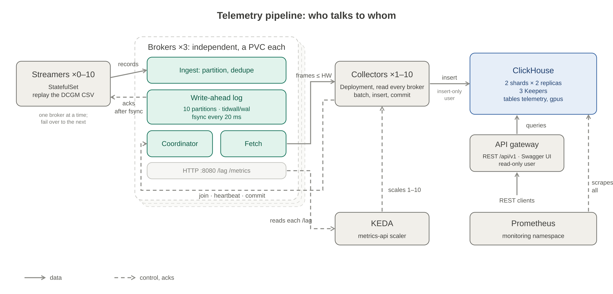
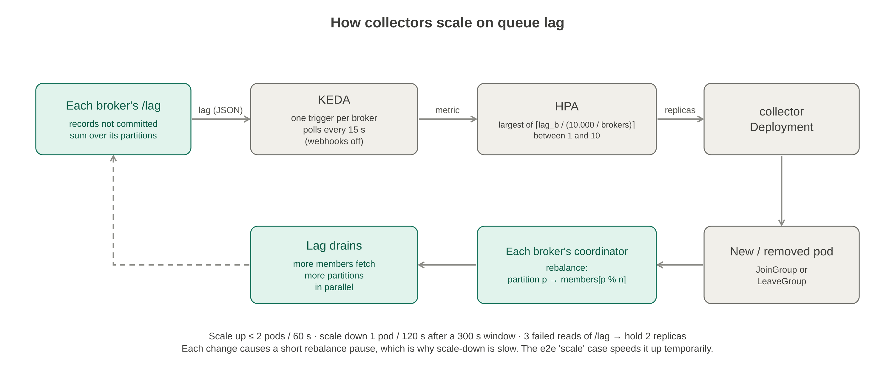

# Elastic GPU Telemetry Pipeline

A telemetry pipeline for an AI cluster, written in Go and deployed to Kubernetes with Helm. Streamers replay DCGM telemetry from a CSV file, custom message brokers queue it, collectors persist it to ClickHouse, and an API gateway serves it over REST.

```
 telemetry-streamer x N  ──gRPC──▶  brokers x 3 (WAL queues)  ──gRPC──▶  collector x M  ──native──▶  ClickHouse  ◀──  api-gateway  ◀── REST clients
 (CSV replay, 0..10;                (independent, 10             (KEDA, 1..10;                (2 shards x 2)     (/api/v1, Swagger UI)
  fail over between brokers)         partitions each)              read every broker)
```



- [Installation workflow](#installation-workflow)
- [Architecture](#architecture)
- [Design choices](#design-choices)
- [Build, test and coverage](#build-test-and-coverage)
- [Repository layout](#repository-layout)
- [How AI was used](#how-ai-was-used)

## Installation workflow

Everything runs on a local minikube cluster. One Makefile at the repo root drives the whole stack; `make help` lists the targets.

### 1. Prerequisites

| Tool | Tested with | Used for |
| --- | --- | --- |
| Docker | 29.9 | Building the images; also the minikube driver |
| minikube | 1.38 | The cluster |
| kubectl | 1.37 | Talking to the cluster |
| Helm | 3.x or 4.x (tested with 4.3) | Installing every component |
| Go | 1.25+ | Only for building, testing and `make swagger` outside Docker |
| jq, python3 | any recent | `make streamers` (jq) and the end-to-end tests (python3) |

### 2. Start minikube

```bash
minikube start --cni=calico --cpus 4 --memory 8192
```

- `--cni=calico` makes the NetworkPolicies in the charts actually enforced. Without a policy-enforcing CNI they are created but ignored.
- 8 GiB of memory leaves room for 4 ClickHouse pods, 3 Keepers, Prometheus and the pipeline. 5–6 GiB is the practical floor; [clickhouse/README.md](clickhouse/README.md) has the full sizing.

### 3. Build the images

```bash
make docker
```

This builds `broker:dev`, `collector:dev`, `api-gateway:dev` and `telemetry-streamer:dev` and loads them into minikube. `SERVICE=<name>` builds just one. Each image goes in as a tarball, and the target fails unless minikube then holds exactly the image just built.

### 4. Deploy the stack

```bash
make deploy
```

This installs, in order, into the namespace `telemetry` (KEDA and monitoring get their own namespaces):

| Step | Release | What it is |
| --- | --- | --- |
| 1 | `clickhouse-operator`, `telemetry-store` | The Altinity operator, then ClickHouse: 2 shards x 2 replicas, 3 Keepers, migrations, users and a 4-hour TTL |
| 2 | `keda` (namespace `keda`) | KEDA, which scales the collectors on queue lag |
| 3 | `prometheus` (namespace `monitoring`) | Prometheus and metrics-server |
| 4 | `broker` | The message queue: 3 independent brokers in a StatefulSet, each with its own persistent write-ahead log |
| 5 | `collector` | The collectors, 1 to 10 replicas, scaled by KEDA |
| 6 | `api-gateway` | The REST API, plus a NodePort Service on port 30080 |
| 7 | `telemetry-streamer` | 2 streamers at 1,000 rows/s each |

`make deploy SERVICE=<name>` installs or upgrades one release. Every app release is rolled back automatically if it doesn't become ready in time.

### 5. Check that it's running

```bash
kubectl -n telemetry get pods             # every pod Running and Ready
kubectl -n telemetry get scaledobject,hpa # KEDA's view of the collectors
make prometheus                           # the Prometheus UI at http://localhost:9090 (Ctrl-C stops it)
```

The API is on the minikube node's NodePort 30080:

```
API:        http://$(minikube ip):30080/api/v1/gpus
Swagger UI: http://$(minikube ip):30080/api/v1/docs
```

The dev chart exposes the API as a NodePort, and your machine reaches the minikube node's IP directly, so nothing needs to stay running.

To use the API on `localhost` instead, for example where the node IP isn't reachable from the host (minikube's docker driver on macOS):

```bash
make api-port        # http://localhost:8080/api/v1/gpus, Swagger UI at http://localhost:8080/api/v1/docs
make api-port-stop   # ends it
```

`make api-port` runs a port-forward in the background and reconnects when the gateway pod changes, so a rollout doesn't break it.

### 6. Scale the load

```bash
make streamers N=5 RATE=2000   # 5 streamers at 2,000 rows/s each (N is 0..10)
make streamers N=0             # stop streaming
```

Collectors follow on their own. KEDA reads every broker's queue lag and runs 1 to 10 collectors, at about 10,000 records of lag per collector.

### Rebuilding one service

```bash
make docker SERVICE=api-gateway   # build, load into minikube, check the image ID there
make deploy SERVICE=api-gateway   # rolls the pods only if the image changed
```

Images are always tagged `dev`, so `make deploy` stamps each pod template with the image ID (the `checksum/image` annotation). A rebuilt image changes the template and Kubernetes rolls the pods; an unchanged one leaves them alone.

### Uninstalling

```bash
make undeploy SERVICE=telemetry-streamer   # one release at a time; SERVICE is any of the deploy steps
minikube delete                            # everything
```

## Architecture

Each component has its own README with details; the design docs under [docs/](docs/) record the reasoning.

| Component | What it does | Runs as | Docs |
| --- | --- | --- | --- |
| **telemetry-streamer** | Replays the CSV in a loop and streams each row to a broker, stamped with the time it is sent. Streams to its home broker and fails over to another, without pausing, when that one goes away | StatefulSet, 0–10 replicas; the pod ordinal is the `streamer_id` | [README](telemetry-streamer/README.md), [design](docs/Component%20Design%20Streamer.md) |
| **broker** | The custom message queue. Partitions records by GPU into a 10-partition write-ahead log, acknowledges producers after fsync, serves consumers and runs the consumer-group coordinator. Several independent brokers share nothing | StatefulSet, 1–5 replicas (3 in dev), a persistent volume each | [README](broker/README.md), [design](docs/Design%20Message%20Broker%20%28WAL%20queue%29.md) |
| **collector** | Joins every broker's consumer group, consumes its assigned partitions, inserts rows into ClickHouse in blocks, and commits offsets only after the insert succeeds | Deployment, 1–10 replicas, scaled by KEDA on each broker's lag | [README](collector/README.md), [design](docs/Collector%20Design%20Queue%20to%20ClickHouse.md) |
| **ClickHouse** | Stores telemetry and the GPU registry | Altinity operator; 2 shards x 2 replicas and 3 Keepers in dev | [README](clickhouse/README.md), [decision record](docs/Decision%20Record%20GPU%20Telemetry%20Storage.md) |
| **api-gateway** | The read-only REST API and its Swagger document | Deployment, 1 replica, NodePort in dev | [README](api-gateway/README.md) |

### The path of one telemetry row

1. **Streamer.** It reads the next CSV row, stamps it with the current time in nanoseconds (the CSV's own timestamp is discarded, as the spec requires) and sends it on a gRPC stream to its home broker (`streamer_id mod brokers`). When it reaches the end of the file, it starts again. If that broker goes away, it fails over to the next one without pausing and resends what was not acknowledged.
2. **Broker.** It hashes the GPU UUID to one of 10 partitions, so each GPU's data stays in order, and appends the row to that partition's write-ahead log. The streamer is acknowledged only after the log is fsynced; group commit fsyncs every 20 ms. Retries are dropped by `(streamer_id, epoch, partition, seq)`.
3. **Collector.** Each broker's coordinator assigns its partitions to the collectors, every one of which consumes from every broker. Each collector fetches its partitions, builds blocks of up to 5,000 rows (or 1 second, or 8 MB), inserts each block into ClickHouse, and only then commits its offsets. The broker deletes consumed log segments within about a second.
4. **ClickHouse.** Rows are sharded by `cityHash64(gpu_uuid)`. The table key `(gpu_uuid, ts, metric_name, streamer_id)` collapses any row delivered twice. A small `gpus` table records each GPU and when it was last seen.
5. **API gateway.** It reads with a read-only, capped ClickHouse user. Every query pins one GPU, so it reads a single shard. Large results are read in chunks of 10,000 rows and streamed to the client.

### Scaling



- **Streamers** are scaled by hand (`make streamers N=…`), 0 to 10. Each one is an independent replay of the whole CSV, so more streamers means more load.
- **Collectors** are scaled by KEDA on every broker's `/lag` endpoint (one trigger per broker), from 1 to 10, which matches the 10 partitions. A scale-up or scale-down rebalances the consumer group: each collector finishes its in-flight insert and commits before partitions move.
- **Brokers** run as 3 independent replicas in dev (1 to 5). Losing one does not stop ingest: its streamers move to the others within milliseconds, without pausing, and what it held is drained when it returns.
- **ClickHouse** scales by shards (for data volume) and replicas (for availability). Reads stay on one shard, because every API request names one GPU.

### Observability

Every service serves `/healthz` (liveness, never dependent on other services), `/readyz` and Prometheus metrics.
- **The cluster Prometheus** (namespace `monitoring`, `make deploy SERVICE=monitoring`) scrapes everything: the streamers, brokers, collectors and API gateway through `prometheus.io/*` pod annotations, ClickHouse and Keeper through their metrics Services, KEDA, and the Kubernetes and node metrics. This is the one to query; [monitoring/README.md](monitoring/README.md) has the PromQL.
- **ClickHouse's own small Prometheus** (`telemetry-store-prometheus`, in `telemetry`) scrapes only ClickHouse, Keeper and the operator, to evaluate the chart's alert rules. The chart also ships a Grafana dashboard.

[docs/diagrams/monitoring-map.png](docs/diagrams/monitoring-map.png) shows what is scraped from where.

## Design choices

The design docs have the full reasoning and the alternatives considered; these are the decisions that shape the system.

**A custom WAL-based broker.**
- Each partition is an append-only log (`tidwall/wal`), with group-commit fsync, crash repair, a disk quota and truncation after consumption added on top.
- Producers are acknowledged only after fsync, so an acknowledged row survives a broker crash.
- Partitioning happens in the broker, by GPU, so streamers stay simple.
- [Broker design](docs/Design%20Message%20Broker%20%28WAL%20queue%29.md).

**Write availability through independent brokers.**
- Three brokers that share nothing: each is a whole queue with its own log, partitions and consumer group. A streamer streams to one at a time, and every collector reads all of them, so a record is safe on whichever broker acknowledged it.
- When a broker goes away, its streamers fail over to the next one at once. Connecting happens in the background, and the 3 s window of unacknowledged records outlasts the slowest failover, so streaming never pauses while any broker is up. A force-killed broker is detected by a 2 s ack timeout.
- A streamer never sends on two brokers at once: a broker drops a record numbered below one it already holds, so overlapping streams could lose data. A record stored twice across a failover is collapsed by ClickHouse's key.
- [Streamer failover design](docs/Component%20Design%20Streamer.md#failover-between-brokers).

**At-least-once delivery, with duplicates removed in three places.**
- The broker drops producer retries.
- Collectors commit offsets only after their ClickHouse insert succeeds, so a crash or rebalance redelivers rather than loses.
- ClickHouse's `ReplacingMergeTree` key collapses anything delivered twice, and the API hides duplicates that haven't been merged away yet.
- The pipeline therefore never needs exactly-once machinery.

**ClickHouse for storage.**
- The data is append-only, time-ordered metrics with a known schema, and every read targets one GPU over a time range.
- A columnar store sorted by `(gpu_uuid, ts)` makes those reads a contiguous scan.
- It compresses metric values to a few bytes each and runs aggregates natively.
- Sharding by GPU, the same key the broker partitions by, spreads writes evenly while keeping every read on one shard.
- [Storage decision record](docs/Decision%20Record%20GPU%20Telemetry%20Storage.md).

**Elastic consumers through a broker-side coordinator.**
- The broker runs consumer groups with generations and fenced commits, so a collector that lost its partitions can't commit stale offsets.
- KEDA scales collectors on lag rather than CPU, because lag is what matters for freshness.

**Backpressure instead of buffering.**
- When ClickHouse slows down, collectors pause fetching, the broker's log grows within its quota, and when the quota is reached the broker pushes back on the streamers, which pause.
- No component buffers without bound, and memory limits (with `GOMEMLIMIT`) stay small.

**A thin, defensive API gateway.**
- It uses a read-only ClickHouse user whose time, memory, row and concurrency caps the gateway can't raise.
- It runs at most 4 queries per pod at a time and returns 429 instead of piling up queries.
- Every request value reaches ClickHouse as a typed query parameter, never as SQL text.
- Unknown query parameters get 400, so a typo can't quietly widen a query.
- Results are complete by default and streamed, so memory stays bounded by one chunk.
- The Swagger document is generated from annotations on the handlers (`make swagger`), and tests fail if it drifts from the code.

**Kubernetes-native operation.**
- Every component has a Helm chart with a values schema, NetworkPolicies, non-root and read-only containers, probes and graceful drains.
- ClickHouse runs under an operator with Keeper for replication.

## Build, test and coverage

| Command | What it does |
| --- | --- |
| `make test` | Unit and integration tests for every Go service, with the race detector and per-package coverage |
| `make coverage` | Coverage per service and in total, plus HTML reports in `coverage/`. Also runs the ClickHouse-backed tests in Docker (`COVER_CH=0` skips them). Fails if a service is under 80 % |
| `make ci` | `vet` (including format and `go mod tidy` checks), `test`, `swagger-check` and `helm-lint`: the gate before a commit |
| `make swagger` | Regenerates the API's Swagger document from the code's annotations |
| `make build` | Builds the binaries into `<service>/bin` |
| `make docker` | Builds the images and loads them into minikube |
| `make -C clickhouse test` | ClickHouse SQL and alert-rule tests, in Docker |
| `bash api-gateway/tests/clickhouse-test.sh` | The gateway's store tests against a throwaway ClickHouse in Docker |
| `make e2e` | The cluster end-to-end suite: load, latency, scaling, broker failover without pausing, crashes, the API checked live against ClickHouse, and no-loss checks |

`make coverage` prints a table like this one, from the time of writing. Generated protobuf code and test-support packages (`broker/pkg/brokertest`, `telemetry-streamer/cmd/fakeserver`) are left out, and a statement counts as covered when any test of its module runs it:

```
service              coverage
broker                  85.3%
collector               86.4%
api-gateway             90.6%
telemetry-streamer      92.1%
total                   88.2%
==> coverage: every service at or above 80%
```

## Repository layout

| Path | Contents |
| --- | --- |
| `telemetry-streamer/`, `broker/`, `collector/`, `api-gateway/` | The four Go services, each its own module with a README |
| `clickhouse/` | ClickHouse tests and operations (the chart is in `helm/clickhouse`) |
| `helm/` | One chart per component |
| `dockerfiles/` | One Dockerfile per service |
| `docs/` | Design docs, the storage decision record, diagrams, the [backlog](docs/BACKLOG.md) and [how AI was used](docs/AI-assistance.md) |
| `e2e/` | The cluster end-to-end suite |
| `monitoring/` | Prometheus values for the monitoring stack |

## How AI was used

The pipeline was built with Claude Code, an AI coding agent. The author brought the requirements and the design docs and made the design decisions; the agent wrote most of the code, tests, charts and docs and ran them on the cluster. [docs/AI-assistance.md](docs/AI-assistance.md) has:
- the workflow;
- who did what;
- the prompts that bootstrapped each part;
- every place a prompt fell short and needed manual intervention.