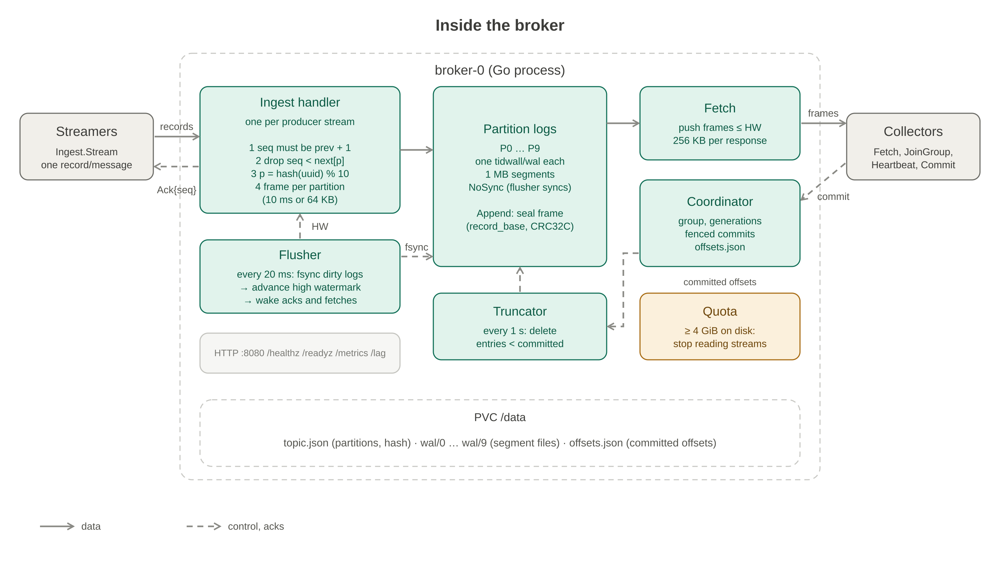
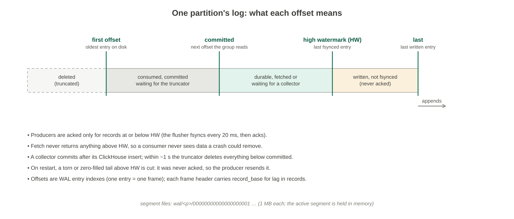
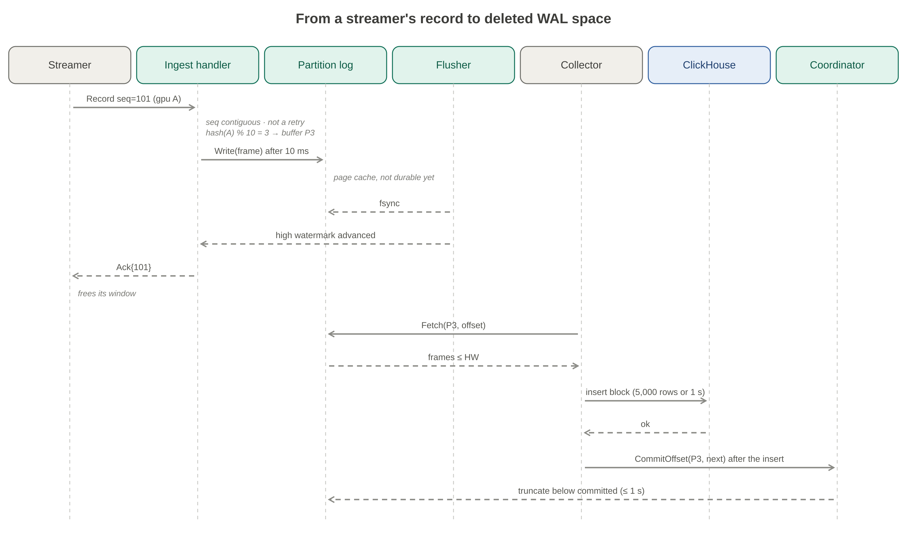
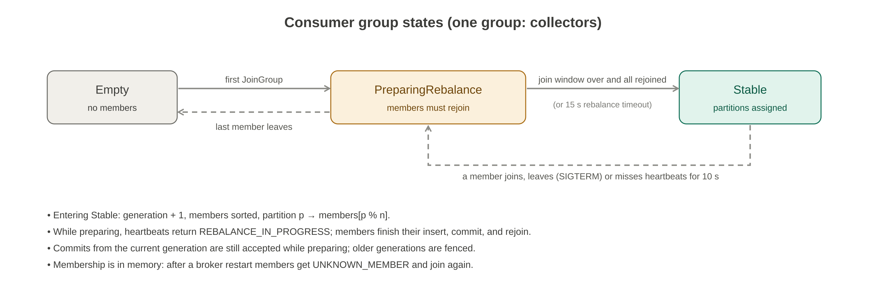
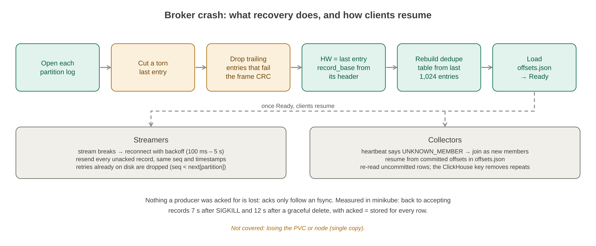

# broker

The broker is the pipeline's message queue. Each broker is a single Go process, and dev runs three independent ones. Each:
- accepts telemetry records from the streamers;
- writes them to a 10-partition write-ahead log (WAL) on a persistent volume;
- acknowledges a record only after it is fsynced;
- serves the log to the collectors;
- runs their consumer group;
- deletes what the group has committed.

**Several brokers.** The brokers share nothing: each has its own WAL volume, partitions and consumer group. Streamers stream to one at a time and fail over to another when it goes away, without pausing. Collectors consume from all of them. That gives write availability, not durability: a record lives on one broker only. See [Several independent brokers](../docs/Design%20Message%20Broker%20%28WAL%20queue%29.md#several-independent-brokers).

The design rationale and the alternatives that were rejected are in [Design Message Broker (WAL queue)](../docs/Design%20Message%20Broker%20%28WAL%20queue%29.md).

| Port | Protocol | Used by |
| --- | --- | --- |
| 7070 | gRPC `telemetry.v1.Ingest/Stream` | Streamers: one record per message in, cumulative `Ack{seq}` back |
| 7070 | gRPC `queue.v1.Broker/Fetch`, `queue.v1.Coordinator/*` | Collectors, through [`pkg/consumer`](pkg/consumer) |
| 8080 | HTTP `/healthz`, `/readyz`, `/metrics`, `/lag` | kubelet, Prometheus, KEDA |

## Inside the broker



| Part | What it does |
| --- | --- |
| **Ingest handler** (one per producer stream) | Checks the sequence, drops retries, routes each record to `hash(gpu_uuid) % 10`, and writes one frame per partition every 10 ms (or at 64 KB) |
| **Partition logs** | One [`tidwall/wal`](https://github.com/tidwall/wal) log per partition |
| **Flusher** | fsyncs every 20 ms and advances each partition's high watermark (HW), which releases acks and wakes waiting fetches |
| **Coordinator** | Assigns partitions to collectors and records their commits |
| **Truncator** | Deletes what the commits cover |

Partitioning happens in the broker, so a streamer stays a simple one-stream client.

## How the WAL is used

### Layout on the volume

Each WAL entry is one **frame**: a 42-byte header followed by records.
- **Header:** CRC32C, `record_base`, record count, partition, `streamer_id`, epoch, and the first and last producer sequence.
- **Each record:** about 58 bytes: `ts_ns`, the 16-byte UUID, the metric name and the value.

An **offset** is the entry's index in its partition's log, starting at 1. The format is defined in [`pkg/frame`](pkg/frame/frame.go).

### What each offset means



### From record to deleted space



1. **Write.** The ingest handler buffers records per partition. Every 10 ms it hands each non-empty buffer to the partition log, which stamps `record_base` and the CRC and appends the frame. The data is now in the page cache, not yet on disk.
2. **Durable.** Every 20 ms the flusher fsyncs each partition written since the last pass (group commit), and moves its HW to the last fsynced entry. When a new segment file was created, it also fsyncs the directory.
3. **Ack.** The handler sends `Ack{seq}` once every partition holding records up to that sequence has an HW past them. Measured ack latency at 1,000 rows/s per streamer: p95 67 ms.
4. **Read.** `Fetch` streams whole frames up to the HW and never past it, so a consumer can't see data a crash could remove.
5. **Commit.** A collector inserts the rows into ClickHouse and only then commits the next offset. The coordinator writes `offsets.json` (tmp file, fsync, rename) before it replies.
6. **Delete.** Once a second, the truncator calls `TruncateFront(committed)`. That deletes the older segment files and rewrites the remainder of the first one (at most 1 MB). Once collectors catch up, the WAL is back to roughly empty: e2e runs measured 0 bytes after draining.

**Backpressure.** If a broker's WAL reaches its quota (4 GiB in dev, a Helm value), every ingest handler stops reading its stream. HTTP/2 flow control then stalls the streamer's stream, its acks stop, and after its ack timeout (2 s) the streamer fails over to another broker. Only when every broker is full does the streamer's pacer block. Nothing is dropped. Producers resume below 90 % of the quota, typically 2 s after ClickHouse comes back.

**Why tidwall/wal, and what the broker adds.** The library provides segments, append and read by index, `Sync` and `TruncateFront`. The broker adds the rest. `internal/plog/spike_test.go` pins each library behaviour this relies on.

| Library behaviour | What the broker does about it |
| --- | --- |
| Opening a log with a torn final entry fails | Cut the segment after its last complete entry, then reopen |
| A zero-filled tail parses as valid empty entries | Drop trailing entries whose frame CRC fails |
| `Read` mutates the segment cache while holding only a read lock | Guard every call into the log with one mutex per partition |
| The last entry can't be deleted without `AllowEmpty` | Turn `AllowEmpty` on, so all consumed data can go |
| The tail segment and the segment cache are held in memory | Use 1 MB segments and a cache of 1, about 2–3 MB per partition |

## Producers: dedupe and acks

A stream identifies its producer with the metadata headers `x-streamer-id` (the pod ordinal, 0–10) and `x-epoch` (random per process start).

| Situation | Broker behaviour |
| --- | --- |
| `seq` is not the previous seq + 1 on the stream | Close the stream with `InvalidArgument` |
| `seq < next[(streamer, epoch)][partition]` | Retry: drop it, and ack once the original is fsynced |
| The same producer opens a second stream | Cancel the old one (`Aborted`); the new one waits until it has exited |
| Bad UUID, or a metric name over 255 bytes | Drop and count; still acked |

The retry table is kept **per partition** on purpose. A resent record always hashes to the same partition, so if a crash cut one partition's tail, the resend restores exactly those records.

## Consumer group



- Collectors call `JoinGroup`, which blocks until the next generation forms.
- They heartbeat every 3 s, with a 10 s session timeout.
- They commit with their generation. Commits from an older generation, or for a partition the member doesn't own, are rejected.
- The generation advances only when the new assignment is computed. So a collector told to rebalance can still commit what it just inserted.

`GET /lag` reports, per partition, the records appended minus the record index at the committed offset. KEDA reads its `lag` field.

## Crash and restart



In the minikube e2e suite, both graceful deletes and SIGKILLs of `broker-0` under 10,000 rows/s ended with acked equal to stored for every row. The broker accepted records again 12 s after a graceful delete and 7 s after a SIGKILL. A shutdown (SIGTERM) proceeds in this order:
1. drop readiness;
2. end fetches;
3. let producer streams write and ack what they hold (`drain_timeout`, 10 s);
4. stop gRPC;
5. write the offsets;
6. run the final fsync.

## Configuration

Every flag is also `BROKER_<NAME>`, set from `helm/broker` values. `bin/broker -h` lists them all.

| Flag | Default | Notes |
| --- | --- | --- |
| `listen`, `http_addr` | `:7070`, `:8080` | gRPC (ingest, fetch, coordinator); HTTP `/healthz` `/readyz` `/metrics` `/lag` |
| `data_dir` | `/data` | WAL, committed offsets and `topic.json` |
| `group` | `collectors` | The consumer group's name |
| `partitions` | 10 | Fixed once `/data` holds data (`topic.json`) |
| `segment_kb` | 1024 | The active segment of every partition is in memory |
| `flush_interval` | 20ms | Group commit; acks wait for it |
| `truncate_interval` | 1s | Deletion of committed entries |
| `quota_mb` | 256 (dev values: 4096) | Producers pause at this much WAL |
| `linger`, `max_frame_kb` | 10ms, 64 | Frame batching per producer stream |
| `fetch_max_kb`, `fetch_max_wait` | 256, 500ms | Fetch defaults |
| `session_timeout`, `heartbeat_interval` | 10s, 3s | Consumer group |
| `join_window`, `rebalance_timeout` | 1s, 15s | Consumer group; the rebalance timeout must exceed the collectors' insert timeout |
| `max_producers` | 1024 | Producer dedupe entries kept |
| `drain_timeout` | 10s | Shutdown: how long producer streams may wait for their final acks |
| `log_level` | `info` | |

Deployment (`helm/broker`):
- A StatefulSet of 1–5 independent replicas (3 in dev), with soft anti-affinity across nodes and a PodDisruptionBudget of one at a time.
- A headless Service that publishes not-ready pods too. Streamers and collectors address each broker by its pod name, `broker-N.broker-headless:7070`; a recovering broker then refuses connections at once instead of timing out. The `broker` ClusterIP Service stays for anything that needs just one.
- A PVC per broker, 6 Gi in dev. minikube's hostpath storage doesn't enforce the size, so the quota is the real cap.
- `/readyz` turns 503 the moment SIGTERM arrives; producer streams then write and ack what they hold and end, which moves their streamers to another broker before this one stops.
- The streamer and collector charts list the brokers from their own `brokers.replicas`, which must match `replicas` here.
- 64 / 128 Mi memory, 500m CPU.
- A NetworkPolicy: gRPC from pods in the namespace; HTTP from the namespace, `keda` and `monitoring`; egress for DNS only.

## Metrics

The full queries are in [monitoring/README.md](../monitoring/README.md).

| Area | Metrics |
| --- | --- |
| Produce | `broker_records_{accepted,duplicate,invalid}_total`, `broker_sequence_gaps_total`, `broker_streams_{opened,fenced}_total`, `broker_ack_latency_seconds`, `broker_quota_blocked`, `broker_quota_blocked_seconds_total` |
| Log | `broker_frames_appended_total`, `broker_fsync_duration_seconds`, `broker_truncations_total`, `broker_recovery_truncated_bytes_total`, `broker_corrupt_ranges_total`, `broker_disk_used_bytes`, `broker_partition_{high_watermark,first_offset,bytes}` |
| Group | `broker_group_lag_records{partition}`, `broker_group_members`, `broker_group_generation`, `broker_rebalances_total`, `broker_commits_{accepted,rejected}_total` |

## Layout

| Path | What it is |
| --- | --- |
| `cmd/broker` | Process wiring, HTTP endpoints, shutdown order |
| `internal/plog` | The WAL: partitions, flusher and high watermark, torn-tail repair, quota, truncation |
| `internal/ingest` | The producer stream: partitioning, dedupe, frame batching, acks |
| `internal/fetch` | The consumer push stream |
| `internal/coordinator` | Consumer group, `offsets.json`, lag |
| `pkg/frame`, `pkg/partitioner` | Frame format and GPU → partition hash (shared with consumers) |
| `pkg/consumer` | Consumer-group client library, used by the collector |
| `pkg/brokertest` | An in-process broker for other modules' integration tests |
| `pkg/queuepb`, `internal/ingestpb` | Generated gRPC code (`bash broker/proto/gen.sh`) |
| `tests/e2e.sh` | Local loss check: ClickHouse in Docker, SIGKILLs midway |

## Build and test

From the repo root (the targets act on all Go services):

```bash
make test                                    # unit and in-process integration tests, race detector
make coverage                                # coverage, generated code excluded: 85 % for the broker
make build                                   # broker/bin/broker
make e2e                                     # in minikube: happy path, load, scaling, broker failover, crashes, ClickHouse down, backpressure
```

In this directory:

```bash
go run ./cmd/broker -data_dir /tmp/broker                              # gRPC :7070, HTTP :8080
go test ./pkg/frame -run '^$' -fuzz FuzzDecode -fuzztime 30s           # fuzz the frame decoder
bash tests/e2e.sh                                                      # local loss check: ClickHouse in Docker, SIGKILLs midway
bash proto/gen.sh                                                      # regenerate the gRPC code
```

Measured in minikube (4 CPUs, 8 GiB) by the cluster e2e suite, with 3 brokers:
- 10,000, 40,000 and 100,000 rows/s offered are sustained; at 100,000, about 99,000 rows/s are accepted and 97,000 inserted.
- At 200,000 rows/s offered, the streamers are the limit: the node's 4 CPUs are saturated, ClickHouse alone using about 4 cores' worth.
- Every run ended with acked equal to stored.
