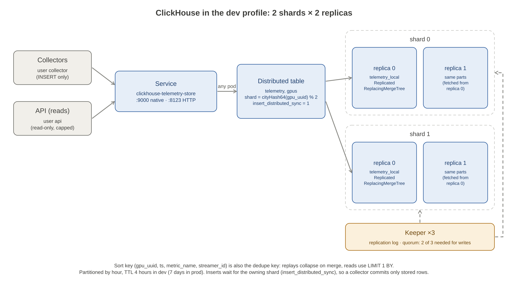

# clickhouse

The telemetry store: a ClickHouse cluster run by the Altinity operator, defined by the chart in
`../helm/clickhouse`. Collectors insert into it through the cluster Service and the API reads from
it. It holds two tables: `telemetry` (every sample, sorted by GPU then time) and `gpus` (the GPU
registry).



**How the collectors write.**
- **Connection:** they connect as the insert-only `collector` user, through the cluster Service, and insert one native block (5,000 rows or 1 s) into the Distributed `telemetry` table.
- **Durability:** the `collector` profile sets `async_insert=0` and `insert_distributed_sync=1`. So an acknowledged insert is stored on its shard, and only then does the collector commit its queue offset.
- **Repeats:** a block retried after a failure, or re-read after a collector crash, carries the same `(gpu_uuid, ts, metric_name, streamer_id)` keys. `ReplacingMergeTree` collapses those rows on merge, and reads hide the unmerged ones with `LIMIT 1 BY`.

## Make targets

Deploying and chart linting go through the root Makefile:
- `make deploy SERVICE=clickhouse` installs the operator, then the release, from the repo root.
- `make helm-lint` lints every chart.

This directory's Makefile has the database's own work. Run `make -C clickhouse help` for the list.

| Target (`make -C clickhouse …`) | What it does |
|---|---|
| `run` / `shell` / `down` | One local ClickHouse in Docker with the dev config and users |
| `test` | `sql-test` and `alerts-test` (offline, needs Docker) |
| `sql-test` | SQL suite in a fresh local container |
| `alerts-test` | `promtool` check and unit tests of the rendered alert rules |
| `cluster-test` | Replica, shard, Keeper and rolling-restart tests against the deployed release |
| `security-test` | Network policy, source-network and credential-rotation tests (needs Calico) |
| `backup-drill` | Back up, destroy and restore the tables (needs `backup.enabled`) |
| `load-test CONFIRM_WIPE=yes` | Ramp the insert rate straight into ClickHouse; truncates `telemetry` |
| `rotate-credentials` / `disk-check` | Rotate one password / disk used by the minikube node |

## Run locally
```sh
make -C clickhouse run        # one ClickHouse in Docker, dev config and users
make -C clickhouse shell      # clickhouse-client inside it
make -C clickhouse sql-test   # the SQL suite in a fresh container
```

## Deploy

Needs a Kubernetes cluster with `kubectl` and `helm` configured.

```
make deploy SERVICE=clickhouse      # from the repo root: operator, then the chart with values-dev.yaml
```

This runs two releases in order: the Altinity operator (`helm.altinity.com`, pinned by
`CH_OPERATOR_VERSION` in the root Makefile), then `telemetry-store`. If the upgrade fails, it rolls
back. For the production profile, run the same two Helm commands with `-f helm/clickhouse/values-prod.yaml`. The migration Job is a `post-install` /
`post-upgrade` hook of the chart, so it starts after the database resources exist and waits for
every host to answer before applying SQL.

Before the first install, check these against your cluster:

```
kubectl get pods -n telemetry --show-labels     # operator pod labels vs networkPolicy.operator
helm search repo altinity-clickhouse-operator --versions   # pick CH_OPERATOR_VERSION
```

## Backups

Backups are off in dev and on in prod. The Altinity operator manages the pods but does not back anything up, so every ClickHouse pod
carries a [clickhouse-backup](https://github.com/Altinity/clickhouse-backup) sidecar (a `backup`
user that only accepts localhost connections). The sidecar on the first replica of each shard
(pod name ending `-0-0`) runs `create_remote` on a schedule (`backup.interval`, `backup.fullInterval`),
and old backups are pruned (`backup.keepRemote`). Backups go to S3-compatible storage under
`<backup.s3.path>/<pod name>/`: in-chart MinIO (available for experiments, off in both profiles), real object storage in
production (`backup.minio.enabled: false`, bucket credentials as `s3-access-key` / `s3-secret-key`
in `auth.existingSecret`). One replica per shard is enough because replicas hold the same data.

`make backup-drill` is the restore drill: it seeds data, uploads a backup per shard, drops the
tables on every replica, restores replica 0 of each shard (schema and data), restores the schema
on the other replicas (they fetch parts by replication), then checks counts, replica equality and
new writes. Not covered: `schema_migrations` (it is rebuilt by rerunning the migration Job) and
point-in-time recovery.

## Retention changes

`retention.ttl` is applied by the migration Job, not only at first install: when the value
differs from the last one recorded in `schema_migrations` (`retention=<ttl>`), the Job runs
`ALTER TABLE ... MODIFY TTL` on the tables, and skips the step when it is unchanged. On a large
table the new TTL is materialised over existing data, which can take a while. The partition
expression (`retention.partition`) cannot be changed on an existing table.

## Users and secrets

| User | Rights | Connects from |
| --- | --- | --- |
| `migrator` | create, alter, drop, select and insert on `default.*`, plus cluster DDL; only the migration Job uses it | `security.allowedNetworks` |
| `collector` | insert into `telemetry`, `gpus` | `security.allowedNetworks` |
| `api` | select from `telemetry`, `gpus`; read-only; caps on time, memory, result rows, rows read, threads and concurrent queries that it cannot raise; a per-minute quota | `security.allowedNetworks` |
| `backup` | what clickhouse-backup needs on `default.*` and `system.*` (only when backups are on) | localhost (the sidecar) |
| `default` | built-in, full rights | localhost only (`kubectl exec`) |

`security.allowedNetworks` is the client source CIDRs (dev: minikube's pod CIDR `10.244.0.0/16`;
prod: set it to your clients' CIDRs). Localhost is always allowed.

Users are defined in ClickHouse config; only password hashes reach the pods, through environment
variables from a Secret. The chart generates random passwords and keeps them across upgrades. To
use your own secret store, set `auth.existingSecret` to a Secret with keys `<user>-password` and
`<user>-password-sha256` for `migrator`, `collector`, `api` and `backup` (plus `s3-access-key` /
`s3-secret-key` when backups are on). Applications read `collector-password` and `api-password`.

Rotation: `make rotate-credentials ROTATE_USER=collector` writes a new password into the Secret and
upgrades. The ClickHouse pod template carries a checksum of the Secret, so the operator rolls the
pods one at a time and they load the new hash; no manual restart. Applications must pick up the new
password from the Secret. The migration Job passes its password through `CLICKHOUSE_PASSWORD`, not
on the command line.

## Network policies

ClickHouse and Keeper pods are default-deny for ingress and egress; Calico (or another enforcing CNI)
is required for this to mean anything.

- **ClickHouse ingress:** pods labelled `telemetry-store/client: "true"` (9000, 8123, plus 9440/8443
  with TLS), the other ClickHouse pods (also 9009/9010 interserver), the migration Job (native port),
  the operator (all ports) and Prometheus (9363, and 7171 with backups). Edit
  `networkPolicy.clients` to admit other namespaces, `networkPolicy.monitoring.from` for an external
  Prometheus (`values-prod.yaml` admits a namespace called `monitoring`).
- **ClickHouse egress:** cluster DNS, the other ClickHouse pods, Keeper (2181/2281), and backup
  storage when backups are on (in-chart MinIO, or 443 for external S3). Add more with
  `networkPolicy.egress.extra`.
- **Keeper:** ingress from ClickHouse, Keeper peers, the operator and Prometheus; egress to DNS
  and peers.
- **Migration Job:** egress to DNS and ClickHouse only.

## TLS

`security.tls.enabled` (off by default) adds a Helm-generated CA (kept across upgrades), a
server certificate for the ClickHouse pods (SANs for every per-pod service and the cluster service),
one for Keeper, and client certificates for `collector` and `api` in the Secrets
`<release>-collector-tls` / `<release>-api-tls`. ClickHouse then also listens on 9440 (native), 8443
(HTTPS) and 9010 (interserver). `security.tls.requireClientCert: true` turns on mTLS. Plaintext ports
stay open: the operator, the migration Job and the tests use them.

## Observability

- **Metrics:** ClickHouse on 9363 and Keeper on 7000 (`/metrics`), plus the operator's exporter.
- **Alerts** (`files/alerts.yaml`, one source): ClickHouse or Keeper down, Keeper quorum lost, Keeper
  session lost, read-only replicas, replication lag and queue, Distributed insert backlog, parts per
  partition, delayed or rejected inserts, insert and query errors, ingestion stalled, disk, memory
  near the limit, merge backlog, and backup failed or too old (when backups are on). Windows come
  from `observability.alerts.for` (dev uses short ones so tests see alerts fire).
- **Cluster Prometheus (dev):** the shared Prometheus in namespace `monitoring` (see
  [monitoring/README.md](../monitoring/README.md)) also scrapes ClickHouse and Keeper:
  - `monitoring.serviceAnnotations` and `monitoring.keeperServiceAnnotations` put the `prometheus.io/*`
    annotations on the metrics Services;
  - `networkPolicy.monitoring.from` admits the `monitoring` namespace.

  Rows stored per shard replica are `rate(ClickHouseProfileEvents_MergeTreeDataWriterRows[1m])`; the
  monitoring README has the query that adds pod names.
- **Dev:** `observability.prometheus.enabled` runs one small Prometheus in the namespace (2 hour
  retention in an emptyDir) that scrapes static targets and evaluates the rules. Read the alerts at `kubectl -n telemetry port-forward svc/telemetry-store-prometheus 9090`
  then http://localhost:9090/alerts.

## Connecting clients

- **Address:** the cluster Service `clickhouse-<release>` (dev: `clickhouse-telemetry-store.telemetry.svc`),
  port 9000 (native) or 8123 (HTTP). Never a pod name: any pod can coordinate a query for every shard,
  and the Service only routes to ready pods.
- **Network policy:** the client pod needs the label `telemetry-store/client: "true"`.
- **Tables:** write to and read from `telemetry` and `gpus` (the Distributed tables), with
  `insert_distributed_sync=1` on inserts (set by the `collector` profile), so an acknowledgement
  means the owning shard has committed the rows.
- **Retry until acknowledged, then commit the queue position.** A pod restart fails the requests in
  flight on that pod; a retry lands on another pod. Resending the same batch is safe: identical blocks
  are dropped by replicated tables, and anything left collapses on merge (`ReplacingMergeTree`) and is
  hidden by `LIMIT 1 BY` until then.
- **Connection pools:** set a maximum connection lifetime (for example `ConnMaxLifetime` in
  clickhouse-go) so connections rebalance after a restart; a Service only balances new connections.
- **Restarts are graceful:** a `preStop` delay (`clickhouse.preStopSleepSeconds`) keeps a pod serving
  until it has left the Service, then ClickHouse finishes running queries for up to
  `clickhouse.shutdownWaitSeconds` before exiting.

## Tests

```
make -C clickhouse sql-test        # SQL tests against a Docker container (single node)
make -C clickhouse alerts-test     # promtool check + unit tests of the rendered alert rules (Docker, offline)
make helm-lint                     # (root) every chart, every values file
make -C clickhouse cluster-test    # needs the deployed release (make deploy SERVICE=clickhouse)
make -C clickhouse security-test   # same; needs Calico; rotates the collector password (SKIP_ROTATION=1 to skip)
make -C clickhouse backup-drill    # needs a release with backup.enabled=true (prod profile, or dev with --set backup.enabled=true); mutates it
```

**The whole pipeline against this cluster:** `make e2e` (see [e2e/README.md](../e2e/README.md)).
It runs the real pipeline: streamers, broker, collectors and this database. It checks that every acked
record is stored exactly once by key, and measures load, latency and writes per shard. It takes shard 1
down (both replicas) under load to check that nothing is committed until the rows are stored.

`cluster-test` checks topology, sharding and replica equality, replay deduplication, access control
and the locked API limits on the cluster tables, then failure modes: one replica down (inserts
continue, replica catches up), one Keeper down (quorum holds), Keeper quorum lost (writes stop, reads
continue, automatic recovery), a whole shard down (only its GPUs fail), and a rolling restart of every
pod under continuous inserts. The rolling-restart loader behaves like a collector: it inserts
through the cluster Service from a client pod and retries a batch until it is acknowledged; the test
fails if any batch is lost, and reports how many retries the restarts caused and why. With the dev Prometheus it also
checks that `ClickHouseDown`, `KeeperQuorumLost` and `ClickHouseReplicaReadOnly` fire during the
outages and clear afterwards. The failure tests scale StatefulSets to 0 and restore them on exit.

`security-test` checks that an unlabelled pod cannot reach ClickHouse and a labelled one can, that
ClickHouse pods resolve DNS and reach peers but not the internet, that a user is refused from an
address outside `security.allowedNetworks`, and that a rotated password works on every pod while the
old one is refused.

## Load test

`make load-test CONFIRM_WIPE=yes` ramps the insert rate through the cluster Service (STEPS, default 10k,
30k, 100k, 250k, 500k rows/s; STEP_SECONDS, default 90; LOADERS, default 4). The loaders are client
pods that generate rows with `clickhouse-local` (250 GPUs x 40 metrics, noisy values) and send one
batch per second each in Native format, waiting for the acknowledgement (`insert_distributed_sync`).
Telemetry is truncated before and after every step. It needs `CONFIRM_WIPE=yes` because it deletes data.

Result on the dev profile (minikube on a 16-thread laptop; 4 ClickHouse pods at 1 GiB, 2 background
merge threads each), 90 s per step, all steps passed with no failed, delayed or rejected inserts:

| Target rows/s | Achieved | Server insert latency p50 / p99 | Max parts in a partition | ClickHouse CPU (all pods) | Bytes per row per copy |
| --- | --- | --- | --- | --- | --- |
| 10,000 | 9,888 | 116 / 415 ms | 8 | 1.1 cores | 7.15 |
| 30,000 | 29,666 | 122 / 198 ms | 10 | 1.1 cores | 6.48 |
| 100,000 | 98,888 | 131 / 257 ms | 12 | 1.3 cores | 6.31 |
| 250,000 | 247,222 | 150 / 299 ms | 9 | 1.8 cores | 6.24 |
| 500,000 | 494,444 | 190 / 381 ms | 15 | 2.4 cores | 6.20 |

Each step stores up to 280 MB per copy at 500k rows/s; the sampler stops a step if `telemetry_local`
passes 3 GB.
