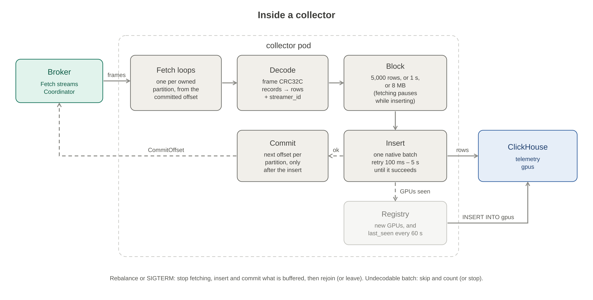

# collector

The collector moves telemetry from the brokers into ClickHouse. It's a stateless Deployment: all its progress lives in the brokers' committed offsets, so any replica can take over any partition. KEDA scales it from 1 to 10 replicas on queue lag.

**Every broker.** The brokers are independent queues (three in dev), and a streamer's records can land on any of them, so each collector consumes from all of them: one consumer per broker, each joining that broker's consumer group, all feeding the same inserts. Each session keeps its own block. A broker that is down stops only its own consumer, which keeps retrying; the others carry on.

Delivery is **at-least-once**. A partition's offset is committed only after its rows are stored. Anything not committed is fetched again by the partition's next owner. A replayed row carries the same `(gpu_uuid, ts, metric_name, streamer_id)` as the original, which is the table's `ReplacingMergeTree` key, so the replay collapses.

## Inside a collector



1. **Join.** It joins the consumer group `collectors` through the broker's Coordinator (with [`broker/pkg/consumer`](../broker/pkg/consumer)). With 10 partitions, members are sorted by ID and partition `p` goes to `members[p % n]`.
2. **Fetch.** It runs one fetch stream per owned partition, starting from the committed offset. The broker only sends fsynced data.
3. **Decode.** Each frame is CRC-checked ([`broker/pkg/frame`](../broker/pkg/frame)) and turned into rows: UUID, nanosecond timestamp, metric, value, plus `streamer_id` from the frame header.
4. **Block.** Rows from every owned partition are inserted as one block when it reaches 5,000 rows, 1 s after its first row, or 8 MB. While the block is being inserted, no more is fetched. That pause propagates back to the broker and on to the streamers.
5. **Insert, then commit.** It does one native batch insert as the insert-only `collector` user, retried from 100 ms to 5 s until it succeeds. Only then does it commit the next offset of every partition in the block. The broker deletes the consumed WAL entries within a second.

**Rebalance.** When a heartbeat reports a rebalance, the collector:
1. stops fetching;
2. inserts and commits what it holds (its generation is still valid while the rebalance is prepared);
3. rejoins.

A commit from an older generation is fenced. The next owner re-reads those rows, and the table key removes the repeats.

**Shutdown (SIGTERM):** stop fetching, insert and commit the buffer, leave the group so the others rebalance at once, and exit within `shutdown_grace` (25 s; the pod's grace period is 30 s).

**Bad data.** A frame that fails its CRC or doesn't decode is logged and counted (`collector_poison_batches_total`). With `poison_policy=skip`, the default, it's committed past, so it can't block a partition. With `stop`, the process exits. A range the broker couldn't read from disk is skipped the same way (`collector_skipped_ranges_total`).

**GPU registry.** Each inserted block reports its GPUs to a background writer. A GPU is written to `gpus` the first time this collector sees it, and again every 60 s while it keeps reporting. Registry writes never hold up inserts or commits.

## Scaling with KEDA


The chart (`helm/collector`) creates a KEDA `ScaledObject` for the Deployment:

| Setting | Value | Why |
| --- | --- | --- |
| Triggers | One `metrics-api` trigger per broker, on `http://broker-N.broker-headless.<namespace>.svc.cluster.local:8080/lag`, field `lag` | KEDA runs in namespace `keda`, so the URLs must be fully qualified. With a single broker (`brokers.replicas: 0`) it is the `broker` Service's `/lag`, and `keda.lagURL` overrides it |
| Target per trigger | `lagTarget / brokers`: 3,333 records with 3 brokers | The HPA follows the largest trigger. Split evenly, that matches 10,000 records of total lag per replica |
| Target | 10,000 records of lag per replica | |
| Replicas | 1–10 | More than 10 would be idle: there are 10 partitions |
| Scale up | at most 2 pods per 60 s | |
| Scale down | 1 pod per 120 s, after a 300 s stabilization window | Every change causes a short rebalance pause |
| Fallback | after 3 failed reads of `/lag`, hold 2 replicas | |

**Installing KEDA.** Run `make deploy SERVICE=keda` from the repo root. It installs KEDA chart 2.20.2 into namespace `keda`, trimmed for the demo machine:
- operator memory limit 192 Mi, metrics server 128 Mi (from 1000 Mi defaults);
- admission webhooks off, since they only validate ScaledObject specs;
- the operator's metrics endpoint on, so Prometheus records `keda_scaler_metrics_value`, the lag KEDA read.

If the KEDA CRDs are missing, the chart renders a plain Deployment with `replicas` (default 1) and says so in its notes.

## Configuration

Every flag is also `COLLECTOR_<NAME>`; flags win.

| Flag | Default | Notes |
| --- | --- | --- |
| `brokers` | (the chart renders one per broker pod) | Broker gRPC addresses, comma-separated; one consumer joins each broker's group |
| `broker` | `broker:7070` | A single broker, used when `brokers` is empty |
| `group`, `client_id` | `collectors`, `$HOSTNAME` | |
| `ch_addr` | `clickhouse-telemetry-store:9000` | ClickHouse native protocol |
| `ch_database`, `ch_user` | `default`, `collector` | The insert-only user from the `telemetry-store` chart |
| `ch_table`, `ch_gpus_table` | `telemetry`, `gpus` | |
| `ch_password` | | Set it through `COLLECTOR_CH_PASSWORD`; the chart reads the Secret `telemetry-store-credentials` |
| `batch_rows`, `batch_wait`, `buffer_mb` | 5000, 1s, 8 | When a block is inserted |
| `insert_timeout` | 10s | Per attempt |
| `poison_policy` | `skip` | `skip` or `stop` |
| `registry_refresh` | 60s | How often a GPU's `last_seen` is rewritten |
| `http_addr` | `:9090` | `/healthz`, `/readyz`, `/metrics` |
| `shutdown_grace` | 25s | Must exceed `insert_timeout` |
| `log_level` | `info` | |

**Why committing after an insert is safe.** The collector's ClickHouse profile sets `async_insert=0` and, on a cluster, `insert_distributed_sync=1`. So a successful insert means the rows are stored on their shard.

**Throughput.** In the cluster load test, ClickHouse spent most of the node's CPU on many small inserts, 5,000 rows each. ClickHouse's own load test reached 494,000 rows/s with blocks of about 37,000 rows. Raising `batch_rows` (and `buffer_mb`) is the cheapest throughput lever.

## Health and metrics

- `GET /healthz` is liveness. It never depends on ClickHouse or the broker; restarting the pod fixes neither.
- `GET /readyz` returns 200 once the collector has joined at least one broker's group and ClickHouse answered the last ping. One broker being down does not make it unready. It turns 503 on SIGTERM.
- `GET /metrics`:

| Area | Metrics |
| --- | --- |
| Inserts | `collector_rows_inserted_total`, `collector_inserts_total`, `collector_insert_errors_total`, `collector_insert_duration_seconds` |
| Commits | `collector_commits_total`, `collector_commits_fenced_total`, `collector_commit_errors_total` |
| Bad data | `collector_poison_batches_total`, `collector_skipped_ranges_total`, `collector_misrouted_records_total` |
| Registry | `collector_registry_upserts_total`, `collector_registry_errors_total` |
| State | `collector_buffer_rows`, `collector_buffer_bytes` (summed over sessions), `collector_assigned_partitions`, `collector_rebalances` (over every broker), `collector_broker_in_group{broker}`, `collector_clickhouse_up`, `collector_ready` |

## Build, test, deploy

From the repo root:

```bash
make test                          # against real in-process brokers (broker/pkg/brokertest) and an in-memory sink
make coverage                      # also runs the sink against ClickHouse in Docker: 86 %
make docker SERVICE=collector      # built with the repo root as context (it imports ../broker), loaded into minikube
make deploy SERVICE=keda           # KEDA itself
make deploy SERVICE=collector      # the Deployment and its ScaledObject, namespace telemetry
```