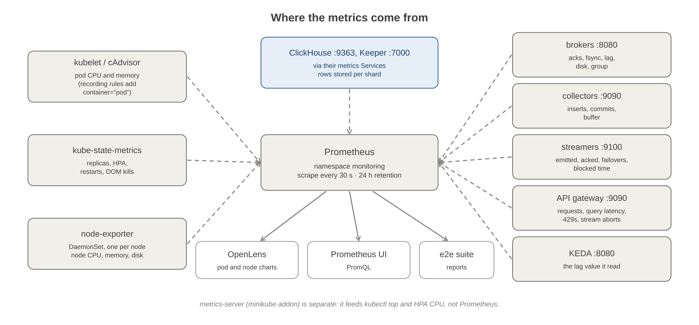

# monitoring

This sets up metrics for the dev cluster: one Prometheus (`prometheus-community/prometheus` 29.35.0, namespace `monitoring`) that collects every component's metrics, plus the minikube metrics-server addon. Nothing is installed inside the application pods. Prometheus only reads (scrapes) their existing `/metrics` endpoints.



```bash
make deploy SERVICE=monitoring     # from the repo root: metrics-server + Prometheus (about 400 MiB)
make undeploy SERVICE=monitoring   # removes Prometheus; its 4Gi PVC stays until deleted
```

| What gets scraped | How |
| --- | --- |
| Pod and node CPU and memory | kubelet and cAdvisor, built into every node (no agent in the pods) |
| Deployments, HPAs, restarts, OOM kills | kube-state-metrics (1 pod) |
| Node CPU, memory and disk | node-exporter: a DaemonSet, one pod per node, so 1 on minikube |
| broker `:8080`, collector `:9090`, streamer `:9100`, api-gateway `:9090` | `prometheus.io/scrape` pod annotations in each chart's `values-dev.yaml`. Each chart's NetworkPolicy admits the `monitoring` namespace on that port |
| KEDA operator `:8080` | The `keda-operator` Service; `make deploy SERVICE=keda` enables its metrics |
| ClickHouse `:9363`, Keeper `:7000` | Their metrics Services, annotated through `monitoring.serviceAnnotations` in `helm/clickhouse/values-dev.yaml`. The ClickHouse NetworkPolicy admits the `monitoring` namespace |

The server keeps 24 h of data (capped at 3 GB) on a 4 Gi volume, scraping every 30 s. Its memory limit is 512 Mi. ClickHouse also keeps its own small Prometheus (`telemetry-store-prometheus` in `telemetry`) for its alert rules.

**metrics-server is separate.** It feeds `kubectl top` and the HPA's CPU metrics, not Prometheus.

## Pipeline queries

Open the Prometheus UI with `make prometheus` (a port-forward of `svc/prometheus-server`; Ctrl-C stops it), then go to http://localhost:9090.

| Question | PromQL |
| --- | --- |
| Rows/s the streamers send | `sum(rate(streamer_rows_emitted_total[1m]))` (each streamer), or `sum(rate(broker_records_accepted_total[1m]))` (what the broker accepted) |
| Rows/s per streamer | `sum by (pod) (rate(streamer_records_acked_total[1m]))` |
| Producer ack latency, p95 | `histogram_quantile(0.95, sum by (le) (rate(broker_ack_latency_seconds_bucket[2m])))` |
| WAL on disk, and quota | `broker_disk_used_bytes`, `broker_disk_quota_bytes` (`broker_quota_blocked` is 1 while producers are paused) |
| Uncommitted records (lag) | `sum(broker_group_lag_records)`, per partition `broker_group_lag_records` |
| Consumers in the group | `broker_group_members`, and `kube_deployment_status_replicas{deployment="collector"}` |
| The lag KEDA read | `keda_scaler_metrics_value{scaledObject="collector-scaler"}` |
| Replicas KEDA asked for | `kube_horizontalpodautoscaler_status_desired_replicas{horizontalpodautoscaler="keda-hpa-collector-scaler"}` |
| Rows/s written to ClickHouse | `sum(rate(collector_rows_inserted_total[1m]))` |
| Inserts/s and insert p95 | `sum(rate(collector_inserts_total[1m]))`, `histogram_quantile(0.95, sum by (le) (rate(collector_insert_duration_seconds_bucket[2m])))` |
| Rebalances, fenced commits, bad batches | `broker_rebalances_total`, `collector_commits_fenced_total`, `collector_poison_batches_total` |
| Streamer failovers, and which broker each uses | `sum by (reason) (increase(streamer_failovers_total[10m]))`, `streamer_connected_broker` |
| API requests/s and p95 | `sum by (route, code) (rate(gateway_requests_total[1m]))`, `histogram_quantile(0.95, sum by (le, route) (rate(gateway_request_duration_seconds_bucket[2m])))` |
| API load shedding and aborted streams | `sum(rate(gateway_requests_total{code="429"}[1m]))` (all 429s), `rate(gateway_rejected_total[1m])` (the part from the gateway's query slots; the rest is ClickHouse's `api` quota), `gateway_stream_aborts_total`, `gateway_inflight_queries` |

## ClickHouse, per shard

ClickHouse series carry the pod IP (`instance`), not the pod name. Join against `kube_pod_info` to see rows stored per shard replica. Use `MergeTreeDataWriterRows`, which counts rows written into a pod's local table. `InsertedRows` also counts the pod that only received and forwarded the insert, so it double-counts.

```promql
sum by (pod) (
  rate(ClickHouseProfileEvents_MergeTreeDataWriterRows{service="telemetry-store-metrics"}[1m])
  * on (instance) group_left (pod)
  label_replace(kube_pod_info{namespace="telemetry", pod=~"chi-.*"}, "instance", "$1:9363", "pod_ip", "(.*)")
)
```