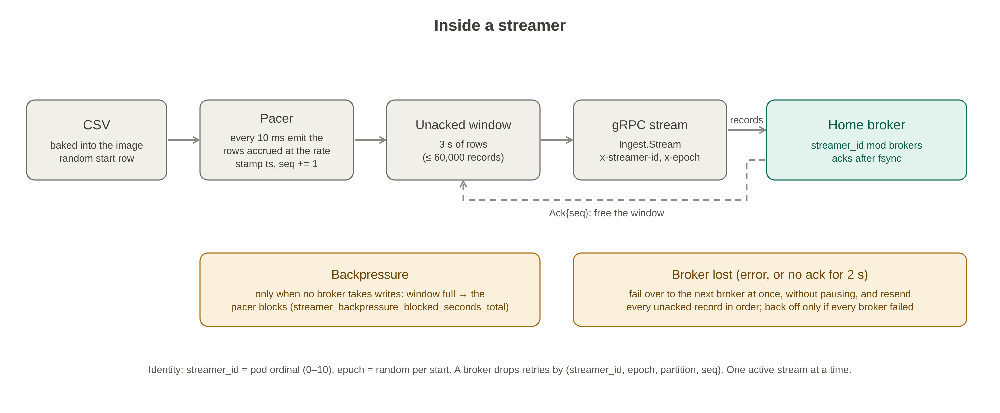

# telemetry-streamer

The streamer replays the DCGM metrics CSV as live telemetry. Each instance:
- reads the CSV in a loop from a random start row;
- stamps every row with the time it emits it (the CSV's own timestamp isn't carried);
- sends rows as **individual records** over one gRPC stream to one of several brokers at a time;
- **fails over between brokers without pausing**, as long as at least one is up.

You scale by running more instances: 0–10 pods in a StatefulSet. The streamer doesn't partition. Every record carries the GPU UUID, and the broker partitions by it. The design, including why failover works the way it does, is in [docs/Component Design Streamer.md](../docs/Component%20Design%20Streamer.md).

## Inside a streamer



- **Pacing:** every `-tick` (10 ms), it emits the rows accrued at `-rate_rows_per_sec` (1–100,000 per instance), so the stream is smooth, not bursty.
- **Acks:** the broker sends a cumulative `Ack{acked_up_to_seq}` once the records are fsynced in its write-ahead log. Records not yet acked stay in a window of `-window` worth of data (3 s), capped at `-window_max_records` (60,000).
- **Brokers:** `-targets` lists them. A streamer's home broker is `streamer_id mod brokers`, so load spreads evenly.
- **Failover:** when a stream breaks, or the oldest record goes unacked for `-ack_timeout` (2 s), the streamer opens a stream to the next broker at once, with no backoff, and resends every unacked record in order with the same sequence number and timestamp. Connecting runs in the background, so rows keep flowing into the window meanwhile. Each attempt is bounded by `-connect_timeout` (1 s). It backs off (100 ms – 5 s) only after every broker has failed in a round. It never sends on two brokers at once.
- **Return home:** while on another broker it tries its home broker every `-home_probe` (10 s). It switches once everything sent elsewhere is acked.
- **Backpressure:** only when no broker accepts writes does the window fill and the pacer block, instead of dropping rows. The time spent blocked is exported as `streamer_backpressure_blocked_seconds_total`, including a block still in progress, so a long stall shows while it happens.
- **SIGTERM:** readiness drops, it stops emitting, waits up to `-grace` (30 s) for the outstanding acks, and logs a final line: `streamer stopped rows_emitted=N records_acked=N unacked_records=0`. The e2e suite's loss check reads that line.

**Reading the stats line.** In the periodic `stats` line, `records_sent` is normally a few dozen ahead of `records_acked`. Those records are in flight: sent, and waiting for the broker's next fsync, which takes up to 20 ms plus 10 ms of batching. That gap isn't loss. The final line on shutdown is the one that counts, and it should show `unacked_records=0`.

**Producer identity.** Every stream carries two metadata headers:
- `x-streamer-id`, 0–65535: from `-streamer_id`, or the pod ordinal in `HOSTNAME` (`telemetry-streamer-3` → 3);
- `x-epoch`, random per process start.

A broker drops resent records it already holds by `(streamer_id, epoch, partition, seq)`. A record fsynced on one broker whose ack was lost is resent to the next and stored twice; ClickHouse keeps `streamer_id` in its deduplication key, which collapses the copy. `-targets` without a streamer ID is refused.

**Contract.** The wire format is `proto/ingest.proto`. The client encodes it by hand (`internal/ingest/codec.go`), so there's no protoc step. The broker generates its server from the same file.

## Configuration

Every flag is also `STREAMER_<NAME>` (for example `STREAMER_RATE_ROWS_PER_SEC`); flags win.

| Flag | Default | Notes |
| --- | --- | --- |
| `csv_path` | (required) | The image sets `/data/telemetry.csv` |
| `rate_rows_per_sec` | 1000 | Per instance, 1–100,000 |
| `tick` | 10ms | Pacing interval |
| `targets` | (empty = discard) | Broker gRPC addresses, comma-separated, e.g. `broker-0.broker-headless:7070,broker-1.broker-headless:7070` |
| `target` | | A single broker address; same as a one-item `targets` |
| `streamer_id` | pod ordinal | 0–65535; required with `-targets` outside a StatefulSet |
| `window`, `window_max_records` | 3s, 60000 | Unacked data held for resend. Refused if shorter than `ack_timeout + connect_timeout`, since a failover would then pause the streamer |
| `connect_timeout`, `ack_timeout`, `home_probe` | 1s, 2s, 10s | Failover timings |
| `mode`, `max_memory_mb` | `auto`, 16 | Rows in memory (16 B/row) unless over budget, then re-read the file |
| `grace` | 30s | Shutdown: wait this long for acks |
| `metrics_addr` | `:9100` | `/healthz`, `/readyz`, `/metrics` |
| `seed` | 0 (random) | Seed for the random start row |
| `stats_interval`, `log_level` | 5s, `info` | |
| `verbose` | false | One line per record; discard mode only |

**Metrics:**
- `streamer_rows_emitted_total`, `streamer_records_sent_total` (includes resends), `streamer_records_acked_total`
- `streamer_retries_total`, `streamer_stream_errors_total`, `streamer_backpressure_blocked_seconds_total`
- `streamer_failovers_total{reason="error|ack_timeout|home"}`, `streamer_connected_broker` (index; -1 while none), `streamer_home_broker`, `streamer_all_brokers_down`
- `streamer_buffer_fullness`, `streamer_send_latency_seconds` (send → ack), `streamer_ready`

## Kubernetes

The chart is `helm/telemetry-streamer`. `make deploy SERVICE=telemetry-streamer` installs it into namespace `telemetry`.
- **A StatefulSet** with parallel pod management, so each pod has a stable ordinal for its `streamer_id`. Scale-down removes the highest ordinals first.
- **Replicas 0–10.** The values schema rejects anything else. The dev default is 2, and 0 stops streaming. Use `--set streamer.replicas=N` and `--set streamer.rateRowsPerSec=R`.
- **The CSV is baked into the image** at `/data/telemetry.csv`, so changing the data means rebuilding the image.
- **Probes:** `/healthz` (liveness, up as soon as the process is) and `/readyz` (CSV loaded and a stream connected to some broker; 503 on SIGTERM).
- **Brokers:** the `brokers` block (`replicas`, `statefulSet`, `headlessService`, `port`) renders `-targets` as one address per broker pod. `brokers.replicas` must match the broker chart's replicas; dev sets 3. With `brokers.replicas: 0` the chart uses `streamer.target` instead.
- **Dev values** stream to the 3 brokers, with a NetworkPolicy egress rule to the broker pods, and `prometheus.io/*` annotations so the cluster Prometheus scrapes `:9100`.

```bash
make docker SERVICE=telemetry-streamer        # from the repo root: build and load into minikube
make deploy SERVICE=telemetry-streamer        # install or upgrade with the dev values
make streamers N=5 RATE=2000                  # set the count (0-10) and, optionally, the rate
```

## Make targets

From the repo root; `fmt`, `vet`, `test` and `build` act on all Go services together:

| Target | What it does |
| --- | --- |
| `make fmt` / `make vet` | Format and tidy / vet, plus fail on unformatted code or an untidy go.mod |
| `make test` / `make build` | Tests with race detector and coverage / binaries into `bin/` |
| `make docker SERVICE=telemetry-streamer` | Build `telemetry-streamer:dev` and load it into minikube |
| `make deploy SERVICE=telemetry-streamer` / `make streamers N=…` | Install or upgrade / set the replica count |
